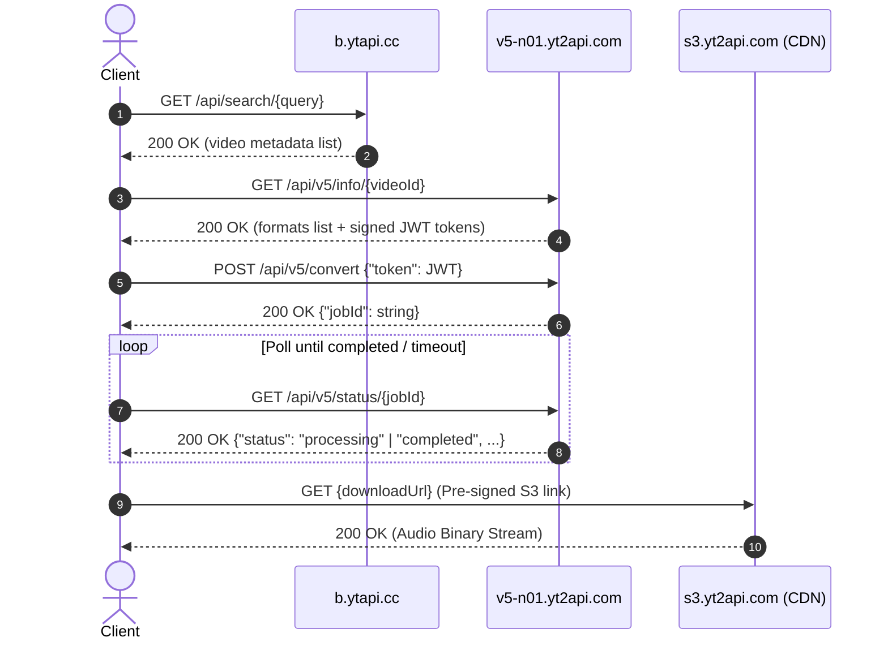

# Audio Providers API Documentation

This document outlines the API specifications for reverse-engineered media endpoints: **yt2api / ytapi** (backend behind `freemp3s.org`) and **Monochrome Tracks API** (`tracks.monochrome.st`).

---

## Table of Contents
1. [Provider 1: yt2api / ytapi (freemp3s.org)](#1-provider-1-yt2api--ytapi-freemp3sorg)
   - [Overview & Base URLs](#11-overview--base-urls)
   - [Execution Flow](#12-execution-flow)
   - [Endpoints](#13-endpoints)
     - [Search Media](#endpoint-1-search-media)
     - [Get Available Formats & Tokens](#endpoint-2-get-available-formats--tokens)
     - [Create Conversion Job](#endpoint-3-create-conversion-job)
     - [Poll Job Status & Download Link](#endpoint-4-poll-job-status--download-link)
   - [Status State Machine](#14-status-state-machine)
2. [Provider 2: Monochrome Tracks API (monochrome.st)](#2-provider-2-monochrome-tracks-api-monochromest)
   - [Overview & Base URLs](#21-overview--base-urls)
   - [Endpoints](#22-endpoints)
     - [Search Tracks](#endpoint-1-search-tracks)
     - [Stream Audio Binary](#endpoint-2-stream-audio-binary)
   - [Audio Codec & Container Detection](#23-audio-codec--container-detection)
3. [Client Integration Guidelines](#3-client-integration-guidelines)

---

## 1. Provider 1: yt2api / ytapi (freemp3s.org)

### 1.1 Overview & Base URLs

The `freemp3s.org` backend delegates search and conversion tasks across two separate hosts:
* **Search Base URL:** `https://b.ytapi.cc`
* **Conversion Node Base URL:** `https://v5-n01.yt2api.com` *(Note: `n01` represents a specific backend cluster worker/shard node)*

### 1.2 Execution Flow



### 1.3 Endpoints

#### Endpoint 1: Search Media
Searches the index for matching video and audio items.

* **Method:** `GET`
* **Path:** `https://b.ytapi.cc/api/search/{query}`
* **Path Parameters:**
  * `query` (`string`, required): Percent-encoded search string (e.g. `Bershy%20Radio`).
* **Headers:**
  * `Accept: application/json`
  * `User-Agent: <client-user-agent>`
* **Status Code:** `200 OK`

##### Response Body (`application/json`):
```json
{
  "videos": [
    {
      "id": "ffwWRqpmUc8",
      "title": "Bershy - Radio (Lyrics) Dispatch Song",
      "thumbDefault": "https://i.ytimg.com/vi/ffwWRqpmUc8/hq720.jpg?...",
      "thumbMedium": "https://i.ytimg.com/vi/ffwWRqpmUc8/hq720.jpg?...",
      "thumbHigh": "https://i.ytimg.com/vi/ffwWRqpmUc8/hq720.jpg?...",
      "channelTitle": "NewMelody",
      "channelId": "UCj4mJaB6K3a6eCw1xIQ2jsA",
      "publishedAt": "11 months ago",
      "duration": "3:23",
      "viewCount": 6225009
    }
  ],
  "continuation": "4qmF3g..."
}
```

##### Field Schema:
| Field | Type | Description |
| :--- | :--- | :--- |
| `videos` | `Array<VideoItem>` | Array of matching media records. |
| `videos[].id` | `string` | Unique 11-character video identifier. |
| `videos[].title` | `string` | Media title. |
| `videos[].thumbDefault` | `string (URI)` | Standard resolution thumbnail. |
| `videos[].thumbMedium` | `string (URI)` | Medium resolution thumbnail. |
| `videos[].thumbHigh` | `string (URI)` | High resolution thumbnail. |
| `videos[].channelTitle` | `string` | Channel / uploader name. |
| `videos[].channelId` | `string` | Unique channel identifier. |
| `videos[].publishedAt` | `string` | Relative publish timestamp. |
| `videos[].duration` | `string` | Duration formatted as `MM:SS` or `HH:MM:SS`. |
| `videos[].viewCount` | `integer` | Ingestion view count. |
| `continuation` | `string \| null` | Pagination token for fetching next page. |

---

#### Endpoint 2: Get Available Formats & Tokens
Retrieves available audio/video codecs, bitrates, and signed conversion tokens.

* **Method:** `GET`
* **Path:** `https://v5-n01.yt2api.com/api/v5/info/{videoId}`
* **Path Parameters:**
  * `videoId` (`string`, required): Unique media ID (e.g. `ffwWRqpmUc8`).
* **Headers:**
  * `Accept: application/json`
* **Status Code:** `200 OK`

##### Response Body (`application/json`):
```json
{
  "videoId": "ffwWRqpmUc8",
  "title": "Bershy - Radio (Lyrics) Dispatch Song",
  "duration": "3:23",
  "formats": {
    "audio": [
      {
        "quality": 320,
        "codec": "lame",
        "ext": "mp3",
        "token": "eyJhbGciOiJIUzI1NiIsInR5cCI6IkpXVCJ9..."
      },
      {
        "quality": 128,
        "codec": "lame",
        "ext": "mp3",
        "token": "eyJhbGciOiJIUzI1NiIsInR5cCI6IkpXVCJ9..."
      }
    ],
    "video": [
      {
        "quality": 1080,
        "codec": "h264",
        "ext": "mp4",
        "token": "eyJhbGciOiJIUzI1NiIsInR5cCI6IkpXVCJ9..."
      }
    ]
  }
}
```

##### Token Format & Lifetime:
Each format object contains an ephemeral HMAC-SHA256 JWT (`HS256`). When decoded:
```json
{
  "videoId": "ffwWRqpmUc8",
  "format": "audio",
  "quality": 320,
  "exp": 1791872281
}
```
* The token contains an expiration timestamp (`exp`). It is valid for a limited window (typically 15–60 minutes) and must be obtained fresh before submitting a conversion job.

---

#### Endpoint 3: Create Conversion Job
Enqueues a media conversion job for a specific format and quality token.

* **Method:** `POST`
* **Path:** `https://v5-n01.yt2api.com/api/v5/convert`
* **Headers:**
  * `Content-Type: application/json`
  * `Accept: application/json`
* **Request Body (`application/json`):**
```json
{
  "token": "eyJhbGciOiJIUzI1NiIsInR5cCI6IkpXVCJ9..."
}
```
* **Status Code:** `200 OK`

##### Response Body (`application/json`):
```json
{
  "jobId": "audio-ffwWRqpmUc8-mp3"
}
```

##### Field Schema:
| Field | Type | Description |
| :--- | :--- | :--- |
| `jobId` | `string` | Asynchronous task ID formatted as `{format}-{videoId}-{ext}`. |

---

#### Endpoint 4: Poll Job Status & Download Link
Polls the conversion status of an active job and returns the pre-signed download link once ready.

* **Method:** `GET`
* **Path:** `https://v5-n01.yt2api.com/api/v5/status/{jobId}`
* **Path Parameters:**
  * `jobId` (`string`, required): The job ID returned from `/api/v5/convert`.
* **Headers:**
  * `Accept: application/json`
* **Status Code:** `200 OK`

##### Response Body (In Progress):
```json
{
  "jobId": "audio-ffwWRqpmUc8-mp3",
  "status": "processing",
  "enum_status": 1,
  "step": "converting",
  "step_progress": 45,
  "progress": 45
}
```

##### Response Body (Completed):
```json
{
  "jobId": "audio-ffwWRqpmUc8-mp3",
  "videoId": "ffwWRqpmUc8",
  "format": "audio",
  "quality": 320,
  "fileFormat": "mp3",
  "title": "Bershy - Radio (Lyrics) Dispatch Song",
  "duration": "3:23",
  "step": "done",
  "step_progress": 0,
  "status": "completed",
  "enum_status": 2,
  "progress": 100,
  "downloadUrl": "https://s3.yt2api.com/yt-cdn-gsg7hsgd/ffwWRqpmUc8/320.mp3?X-Amz-Algorithm=AWS4-HMAC-SHA256&X-Amz-Expires=600&..."
}
```

### 1.4 Status State Machine

| `enum_status` | `status` String | Meaning | Recommended Client Action |
| :---: | :--- | :--- | :--- |
| `0` | `pending` / `queued` | Queued in worker pool | Sleep 1500ms, then poll again. |
| `1` | `processing` | Actively encoding / multiplexing | Sleep 1000ms, then poll again. |
| `2` | `completed` | Conversion finished; `downloadUrl` available | Fetch audio stream from `downloadUrl`. |
| `-1` | `failed` / `error` | Source unavailable or transcode failed | Terminate job and emit error. |

> **Note on `downloadUrl` Expiration:** The URL contains an AWS S3 presigned signature valid for `600` seconds (10 minutes). The stream must be consumed immediately and should not be stored permanently.

---

## 2. Provider 2: Monochrome Tracks API (monochrome.st)

### 2.1 Overview & Base URLs

The `monochrome.st` API serves track search and direct binary audio streaming.
* **Base URL:** `https://tracks.monochrome.st`

### 2.2 Endpoints

#### Endpoint 1: Search Tracks
Searches catalog tracks and related metadata.

* **Method:** `GET`
* **Path:** `https://tracks.monochrome.st/search/tracks`
* **Query Parameters:**
  * `q` (`string`, required): URL-encoded query string (e.g. `Radio%20Bershy`).
  * `limit` (`integer`, optional, default: `20`, max: `50`): Maximum results to return.
* **Headers:**
  * `Accept: application/json`
  * `User-Agent: <client-user-agent>`
* **Status Code:** `200 OK`

##### Response Body (`application/json`):
```json
{
  "tracks": [
    {
      "id": "209150978007162880",
      "trackId": "209150978007162880",
      "title": "Radio",
      "artistIds": [
        "209222154837970944"
      ],
      "artistNames": [
        "Bershy"
      ],
      "releaseId": "209150944829718528",
      "artwork": "https://tracks.monochrome.st/proxy/mi/209150944829718528-1A01.jpg",
      "explicit": false,
      "playable": true,
      "duration": 201853,
      "isrc": "GBWUL2270670",
      "recordingId": "209223031103426560",
      "searchPriority": 0
    }
  ],
  "releases": [],
  "artists": [],
  "topResults": [],
  "users": [],
  "playlists": []
}
```

##### Field Schema:
| Field | Type | Description |
| :--- | :--- | :--- |
| `id` / `trackId` | `string` | 64-bit integer ID encoded as string. |
| `title` | `string` | Track title. |
| `artistIds` | `string[]` | Array of artist identifiers. |
| `artistNames` | `string[]` | Array of human-readable artist names. |
| `releaseId` | `string` | Album or release identifier. |
| `artwork` | `string (URI)` | Proxied album art image URL. |
| `explicit` | `boolean` | Explicit content flag. |
| `playable` | `boolean` | Playability / stream availability flag. |
| `duration` | `integer` | Track duration in **milliseconds** (e.g. `201853` = ~3m 21s). |
| `isrc` | `string` | International Standard Recording Code. |
| `recordingId` | `string` | Master recording identifier. |

---

#### Endpoint 2: Stream Audio Binary
Streams the binary audio file for the specified `trackId`.

* **Method:** `GET`
* **Path:** `https://tracks.monochrome.st/track/{trackId}`
* **Path Parameters:**
  * `trackId` (`string`, required): Track ID from search results (e.g. `209150978007162880`).
* **Headers:**
  * `Accept: audio/*, application/octet-stream`
  * `Range: bytes=0-` *(optional, enables chunked range requests and seeking)*
* **Status Codes:**
  * `200 OK` (full binary download)
  * `206 Partial Content` (range request response)
  * `404 Not Found` (invalid or unavailable track)

### 2.3 Audio Codec & Container Detection

The raw binary returned by `GET /track/{trackId}` can be identified via the following detection sequence:

1. **HTTP `Content-Type` Header:**
   * `audio/flac` -> Free Lossless Audio Codec (FLAC). *(Standard for `monochrome.st` high-fidelity streams)*
   * `audio/mp4` or `audio/m4a` -> AAC / ALAC in ISO BMFF container.
   * `audio/mpeg` -> MP3 audio.
   * `application/octet-stream` -> Fallback to magic byte detection below.

2. **HTTP `Content-Disposition` Header:**
   Check for attachment filename extensions:
   ```http
   Content-Disposition: attachment; filename="Bershy - Radio.flac"
   ```

3. **Magic Byte Signatures (First 4–8 bytes):**
   * **FLAC:** `0x66 0x4C 0x61 0x43` (ASCII `"fLaC"`).
   * **MP3 (ID3v2):** `0x49 0x44 0x33` (ASCII `"ID3"`).
   * **MP3 (MPEG Frame Sync):** `0xFF 0xFB`, `0xFF 0xF3`, or `0xFF 0xF2`.
   * **M4A / MP4:** Bytes 4–8 contain `0x66 0x74 0x79 0x70` (ASCII `"ftyp"`).
   * **Ogg / Opus:** `0x4F 0x67 0x67 0x53` (ASCII `"OggS"`).

---

## 3. Client Integration Guidelines for Download Extensions

1. **Direct-to-Disk Chunked Streaming (RAM Budget):**
   * Do not buffer complete audio downloads into WASM memory (a 50MB FLAC would immediately breach Lyria's 40MB RAM budget).
   * Stream chunks directly to disk via Tauri IPC or Rust host file sink using bounded stream buffers (e.g. 64KB chunks via `reqwest::Response::bytes_stream()`).

2. **Progress Reporting for Download UI:**
   * **yt2api:** Expose the `progress` (0–100) and `step` values from `/api/v5/status/{jobId}` directly to Lyria's download manager UI during transcode, followed by bytes-received progress during the final S3 download.
   * **Monochrome:** Track download progress using the HTTP `Content-Length` header returned from `GET /track/{trackId}` against streamed bytes received.

3. **Metadata Retention & File Naming:**
   * **yt2api:** Generate filename from the status payload: `"{title}.{fileFormat}"` (sanitized of illegal OS path characters).
   * **Monochrome:** Extract metadata from the search response:
     * Filename: `"{artistNames[0]} - {title}.flac"`
     * Retain `artwork`, `isrc`, and `releaseId` to embed tags (ID3 / Vorbis Comments) before inserting the track into Lyria's SQLite database.

4. **Origin Headers for Search (yt2api / freemp3s):**
   * Calls to `https://b.ytapi.cc/api/search/{query}` require browser headers to avoid `403 Forbidden`:
     * `Referer: https://freemp3s.org/`
     * `Origin: https://freemp3s.org`
     * Standard modern browser `User-Agent`.

5. **Ephemeral S3 Link Consumption:**
   * The S3 pre-signed `downloadUrl` expires after 10 minutes (`X-Amz-Expires=600`). The file download must be initiated immediately upon receiving the `completed` status.
